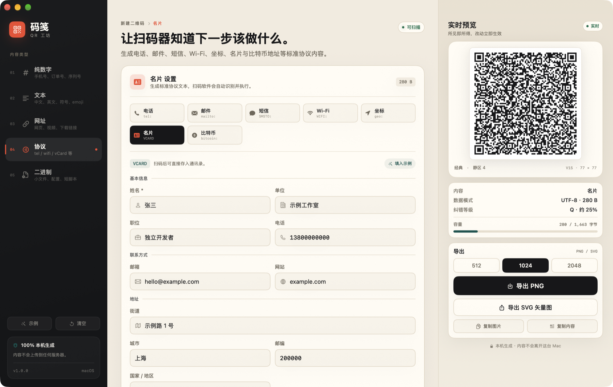

# 码笺 · QR 工坊

> 把数字、文字、链接、协议和字节，装进一枚安静的二维码。

[](https://github.com/ThecangShengdance/Majian/actions/workflows/ci.yml)
[](https://github.com/ThecangShengdance/Majian/releases/latest)

码笺（Majian）是一个原生 macOS 二维码生成器，使用 SwiftUI 编写，**完全离线、零第三方运行时依赖**。左侧选内容类型，中间编辑，右侧实时预览；改一个字段，二维码立刻重排。



## 下载

从 [GitHub Releases](https://github.com/ThecangShengdance/Majian/releases/latest) 下载 `Majian-1.0.0.zip`，解压后把 `Majian.app` 拖进「应用程序」。

当前版本为 ad-hoc 签名，首次打开如被 Gatekeeper 拦截，可在「系统设置 → 隐私与安全性」中选择「仍要打开」。应用不需要网络权限，也不会把二维码内容发送到任何服务器。

## 功能

| 内容类型 | 适合放什么 | 处理方式 |
| --- | --- | --- |
| **纯数字** | 手机号、订单号、序列号、ID | 自动忽略空格、连字符等非数字字符，使用数字模式 |
| **文本** | 汉字、英文、符号、emoji | 原样 UTF-8 编码，自动选择数字 / 字母数字 / 字节模式 |
| **网址** | 网页、B 站、下载链接 | 缺省自动补全 `https://`，校验 scheme 与 host |
| **协议** | 电话、邮件、短信、Wi-Fi、坐标、名片、比特币 | 生成标准协议文本，扫码软件自动识别 |
| **二进制** | 短配置文件、短脚本、任意字节 | 原始字节编码，不做 Base64 转换 |

### 七种结构化协议

| 协议 | 生成格式示例 |
| --- | --- |
| 电话 | `tel:+8613800000000` |
| 邮件 | `mailto:hi@example.com?subject=Hello%20Majian&body=...` |
| 短信 | `SMSTO:13800000000:Hello`，或 Apple 的 `sms:13800000000?body=...` |
| Wi-Fi | `WIFI:T:WPA;S:Majian Studio;P:majian2026;;` |
| 坐标 | `geo:31.2304,121.4737?q=上海外滩` |
| 名片 | vCard 3.0，含 `FN` / `ORG` / `TITLE` / `TEL` / `EMAIL` / `ADR` / `URL` / `NOTE` |
| 比特币 | `bitcoin:bc1...?amount=0.0012&label=Majian`（BIP21） |

协议文本会按规范转义：Wi-Fi 的 `\;,:"`、vCard 的 `\;,\n`、URL 查询参数均会处理。名片使用 CRLF 换行。

### 外观与导出

- **纠错等级**：L / M / Q / H，默认 Q（约可恢复 25%）
- **模块样式**：经典、柔和圆角、点阵
- **颜色**：6 组预设前景 + 3 组背景，也可用系统取色器
- **对比度提示**：实时计算 WCAG 对比度，检测浅色码 / 深色底
- **容量条**：按当前模式与纠错等级显示占用比例
- **导出**：PNG 512 / 1024 / 2048 px，或矢量 SVG；也可直接复制图片 / 内容
- 所有导出均自带 **4 模块静区**，不依赖扫码器自动裁边

### 快捷键

| 操作 | 快捷键 |
| --- | --- |
| 新建二维码 | `⌘N` |
| 载入示例 | `⌘L` |
| 导出 PNG | `⌘S` |
| 导出 SVG | `⇧⌘S` |
| 复制二维码图片 | `⇧⌘C` |
| 复制二维码内容 | `⌥⌘C` |

## 构建

要求：

- macOS 14 或更高
- Xcode 16 或更高（项目使用 objectVersion 77）
- 无需 CocoaPods / SwiftPM / 网络依赖

```bash
git clone https://github.com/ThecangShengdance/Majian.git
cd Majian
./build.sh
```

产物为 `Dist/Majian.app` 和 `Dist/Majian-1.0.0.zip`；分发时使用 zip（扩展属性已排除，签名可校验），解压后把 `Majian.app` 拖进「应用程序」即可。构建脚本使用 ad-hoc 签名，首次打开如被 Gatekeeper 拦截，可在「系统设置 → 隐私与安全性」中选择「仍要打开」。

也可以直接用 Xcode 打开 `Majian.xcodeproj`，选择 `Majian` scheme 运行。若在受限沙箱环境中遇到 Swift 宏错误（`external macro implementation type 'SwiftUIMacros.StateMacro' could not be found`），给 Build Settings 的 `OTHER_SWIFT_FLAGS` 加上 `-disable-sandbox`，或直接使用 `build.sh`。

## 验证

项目自带无头验证脚本，不依赖 UI：

```bash
./Tests/verify.sh
```

它会依次执行：

1. 构造 5 类内容与 7 种协议的 payload；
2. 用纯 Swift 编码器生成矩阵；
3. 用 Core Graphics 渲染 720 px PNG，并生成 SVG；
4. 用 **Vision** 扫码回读，逐项比对原文；
5. 覆盖 L / M / Q / H 四种纠错、三种 PNG / SVG 样式与错误路径。

预期结尾：

```text
PASS 二进制字节  v2  25×25  13 B
PASS 纠错 L  v2
PASS 纠错 M  v3
PASS 纠错 Q  v3
PASS 纠错 H  v4
PASS PNG classic
PASS SVG classic  3240 B
PASS PNG soft
PASS SVG soft  23296 B
PASS PNG dots
PASS SVG dots  13748 B
PASS 拒绝空数字
PASS 拒绝缺少 scheme 的网址
PASS 超容量内容被拒绝
ALL PASS
```

> 二进制载荷无法用 Vision 当作文本回读，测试只验证矩阵与 PNG 生成成功；这是二维码标准对字节模式的限制，不是渲染问题。

## 二进制模式的边界

二维码字节模式在 L 级最多 **2,953 字节**，H 级只有 **1,273 字节**。码笺在读取文件时限制 4,096 字节，仅用于判断是否超限并预览前 64 字节；真正可导出的内容不能超过当前纠错等级的上限。

普通相机通常把字节模式当作文本解码，因此任意二进制可能显示乱码或直接失败。需要最大兼容性时，把二进制转成 Base64 再放进「文本」模式；码笺仍保留原始字节模式，用于明确支持它的扫码器。

## 技术说明

```text
Sources/
├── App/            应用入口、根布局
├── Core/
│   ├── Payload.swift       5 类内容 → 标准 payload
│   ├── QRCodeEngine.swift  矩阵生成、PNG/SVG 渲染
│   └── Vendor/             MIT 纯 Swift QR 编码器
├── Model/          ObservableObject 状态与导出动作
├── Views/          侧栏、编辑器、协议表单、预览栏
└── Resources/      AppIcon、AccentColor
Tests/              无头验证
```

- **纯 Swift 编码**：矩阵由 Nayuki / fwcd 的 MIT 实现生成，再映射为 `QRMatrix`；渲染器自行加 4 模块静区，经典样式按行合并连续模块，保证像素边缘锐利。
- **不依赖 Core Image**：macOS 27 上 `CIContext` 在部分 GUI 进程初始化 Metal binary archive 时会抛 `NSInvalidArgumentException` 崩溃；即使指定软件渲染也会走 Metal 初始化。码笺因此移除了 `CIQRCodeGenerator`，改为纯 Swift 编码，生成结果稳定且可测试。
- **无网络权限**：应用不包含网络请求代码，文件只在本机读取；侧栏底部标注「100% 本机生成」。
- **无沙盒**：为方便拖入任意本地文件，当前构建关闭 App Sandbox；如要上架 Mac App Store，需要改为安全作用域书签方案。

## License

MIT。第三方编码器的版权与许可见 [THIRD_PARTY_NOTICES.md](THIRD_PARTY_NOTICES.md)。

`build.sh` 会把 `LICENSE` 与 `THIRD_PARTY_NOTICES.md` 一并放进 `Majian.app/Contents/Resources/`，应用菜单「码笺 → 第三方许可」可直接打开。二维码图案属于公开标准；「QR Code」是 DENSO WAVE INCORPORATED 的注册商标，本项目仅作描述性使用。

许可与名称风险审查记录见 [Docs/license-audit.md](Docs/license-audit.md)。

## 参与

欢迎提交 Issue 或 Pull Request。开发与验证方式见 [CONTRIBUTING.md](CONTRIBUTING.md)，版本记录见 [CHANGELOG.md](CHANGELOG.md)。
